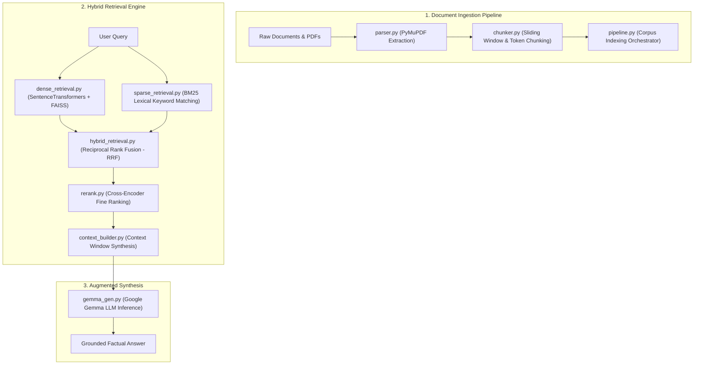

# 🧠 RAG From Scratch — Hybrid Retrieval-Augmented Generation

[](https://www.python.org/)
[](https://github.com/facebookresearch/faiss)
[](https://huggingface.co/)
[](https://ai.google.dev/gemma)
[](https://python.org)

A pure Python, framework-agnostic **Retrieval-Augmented Generation (RAG)** engine built entirely from scratch without heavy abstractions (no LangChain or LlamaIndex). Designed for maximum transparency, deterministic debugging, and production-grade retrieval performance.

---

## 🏛️ System Architecture



---

## ⚡ Key Architectural Innovations

### 1. Hybrid Retrieval & Reciprocal Rank Fusion (RRF)
Vector embeddings capture latent semantic relationships, but often miss exact product codes, acronyms, or specific nomenclature. Conversely, keyword search (BM25) guarantees lexical precision but lacks semantic understanding.

This engine merges dense vector rankings ($R_{\text{dense}}$) and sparse BM25 rankings ($R_{\text{sparse}}$) using Reciprocal Rank Fusion with smoothing factor $k=60$:
$$\text{RRF Score}(d) = \frac{1}{k + R_{\text{dense}}(d)} + \frac{1}{k + R_{\text{sparse}}(d)}$$

### 2. Cross-Encoder Reranking
Top-$K$ fused candidates are subsequently re-scored through a dedicated Cross-Encoder network (`rerank.py`) that models cross-attention between `(Query, Passage)` pairs, eliminating irrelevant passages before context injection.

### 3. Lightweight & Transparent Codebase
- Zero hidden prompts, mysterious callbacks, or framework dependency hell.
- Complete modular independence across ingestion, retrieval, reranking, and generation layers.

---

## 📁 Repository Structure

```
├── ingestion/
│   ├── parser.py              # PDF and document text extraction via PyMuPDF
│   ├── chunker.py             # Overlapping sliding window and sentence chunker
│   └── pipeline.py            # Corpus parsing and vector index build pipeline
├── retrieval/
│   ├── dense_retrieval.py     # Dense embedding generation and FAISS vector search
│   ├── sparse_retrieval.py    # BM25 frequency-based lexical retrieval
│   ├── hybrid_retrieval.py    # Reciprocal Rank Fusion (RRF) scoring algorithm
│   ├── rerank.py              # Cross-Encoder score refinement
│   └── context_builder.py     # Prompt grounding and context truncation
├── generation/
│   └── gemma_gen.py           # Generation inference with Google Gemma
├── requirements.txt           # Minimal dependencies
└── README.md
```

---

## 🚀 Quickstart & Setup

### Prerequisites
- Python 3.10+
- Hugging Face API Token (optional, for gated model weights)

### 1. Installation
```bash
git clone https://github.com/karnam-ui/rag-from-scratch.git
cd rag-from-scratch
pip install -r requirements.txt
# Core packages: pymupdf sentence-transformers faiss-cpu transformers torch
```

### 2. Ingest Documents
Place your source PDFs or text documents in a directory and run the ingestion orchestrator:
```bash
python -m ingestion.pipeline --input_dir ./data
```

### 3. Query the Engine
```bash
python -m retrieval.hybrid_retrieval --query "Explain the core mechanism"
```

---

## 📄 License
This project is open-source under the [MIT License](LICENSE).
